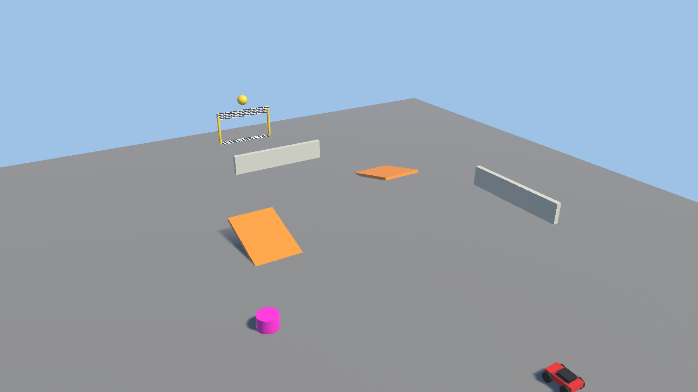

# 上級 2. スクリプトを書こう

> **このページでやること**：C#（シーシャープ）というプログラムの言葉でスクリプトを書いて、新しい走り方の部品 `MyDrive` を作る。
> **使うシーン**：`Assets/Scenes/01_Lesson_Parts`
> **目安**：15 分



## スクリプトってなに？

授業の 2 章で付け替えた **ArcadeDrive** や **DriftDrive** は、C# で書かれた **スクリプト**（プログラムのファイル）でできています。
自分でスクリプトを書けば、まだ無い部品を作れます。

## 5-1. スクリプトを作る（3 分）

1. Project ウィンドウで `Assets/Scripts/Parts/Drive/` を開きます。
2. 右クリック → **Create** → **MonoBehaviour Script** を選び、名前を `MyDrive` にします。
   （名前は **ファイル名とクラス名を同じ** にする必要があります）
3. ダブルクリックして、コードエディタで開きます。

## 5-2. コードを書く（7 分）

中身を全部消して、次のコードを書きます（コピー＆ペーストで OK）。

```csharp
using UnityEngine;

namespace VantanSchoolFestival2026
{
    /// <summary>自分で作った駆動方式。</summary>
    [AddComponentMenu("VantanSchoolFestival2026/駆動方式/マイドライブ (MyDrive)")]
    [ComponentSummary("自分で作った駆動方式です。", "RCCar に 1 つだけ付けます。")]
    public class MyDrive : DriveBase   // ← 走り方の部品の「ひな形」を使う
    {
        [Tooltip("進む速さ（メートル/秒）。")]
        [SerializeField] private float _speed = 10f;

        [Tooltip("曲がる速さ（度/秒）。")]
        [SerializeField] private float _turnSpeed = 90f;

        // DriveBase から呼ばれる。ここに「どう走るか」を書く
        protected override void Drive(Vector2 input, float control, float deltaTime)
        {
            SplitVelocity(out Vector3 flat, out Vector3 vertical);

            // 前に進む速度を、そのまま設定する
            flat = transform.forward * (input.y * _speed * Car.SpeedMultiplier);
            Body.linearVelocity = flat + vertical;

            // 曲がる
            Turn(input.x * _turnSpeed * control * deltaTime);
        }
    }
}
```

| コードの部分 | 意味 |
| --- | --- |
| `: DriveBase` | 走り方の部品の「ひな形」を使う。どの走り方でも同じ部分は、もう書いてあるので書かなくてよい（「継承」といいます） |
| `[SerializeField]` | Inspector に値を出す |
| `[Tooltip("…")]` | Inspector でマウスを乗せたときの説明 |
| `input.y` / `input.x` | アクセル（前後）とハンドル（左右）。-1 〜 1 |

## 5-3. 付けて走らせる（5 分）

1. 保存して Unity に戻ると、少し待ってから、書いたプログラムが Unity に読み込まれます（「コンパイル」といいます）。
2. RCCar の駆動方式を外し、**Add Component** → **VantanSchoolFestival2026** → **駆動方式** → **マイドライブ** を付けます。
3. ▶ で走らせてみましょう。Inspector で Speed と Turn Speed を変えてみましょう。

> ⚠ Console に赤いエラーが出たら、打ち間違いがないか確認しましょう。
> よくあるのは `;` の付け忘れ、`{` と `}` の数が合っていない、大文字と小文字の間違いです。

## チャレンジ（早く終わった人）

- アクセルを押していなくても勝手に前に進む「自動走行ドライブ」を作ってみよう。
- `JumpParts.cs` を参考に、ボタンを押すと車が小さくなる「ミニパーツ」を作ってみよう（ヒント：`transform.localScale`）。
- `Bumper.cs` を参考に、乗ると上に飛ばされる「トランポリン」を作ってみよう。
- `PlayerCarInput.cs` を参考に、車に「ずっと前進＋ときどきジャンプ」の命令を送る「AI ドライバー」を作ってみよう。
  （ヒント：`RCCar.SetDriveInput()` と `RCCar.RequestJump()` を呼ぶだけ）

> ✅ **確認**：Add Component のメニューに「マイドライブ」が出て、車が走りましたか？

---

[← 上級 1. 問題を直そう](01_debug.md) ｜ [目次](../index.md) ｜ [上級 3. しくみを知ろう →](03_how-it-works.md)
