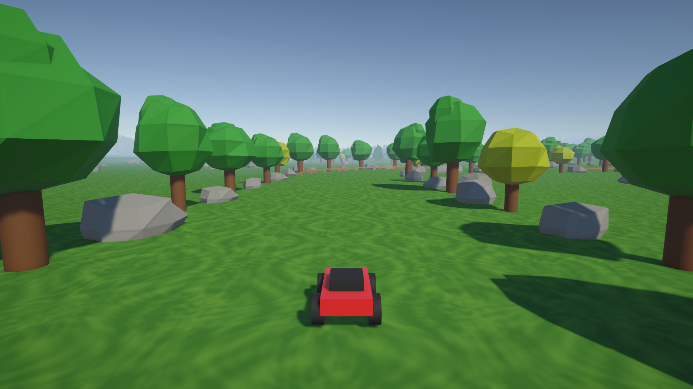

# はじめての Unity ラジコン

Unity を初めて触る人が、**ラジコンカーのゲーム**を通して Unity の基本操作に慣れるための教材です。
**90 分の授業**で使う教材と、プロジェクト全体の**マニュアル**をまとめています。

このページは次の 2 か所で読めます。

- **Web**：GitHub Pages
- **Unity エディタ**：メニューの **VantanSchoolFestival2026 → マニュアル・教材**

---

## 授業の教材（90 分）

| 時間 | 内容 | ページ |
| --- | --- | --- |
| 10 分 | Unity の画面を知って、遊んでみる | [1. はじめよう](lesson/01_intro.md) |
| 20 分 | コンポーネントを付け替えて、車を改造する | [2. 車を改造しよう](lesson/02_components.md) |
| 20 分 | 部品を置いて、自分のコースを作る | [3. コースを作ろう](lesson/03_stage.md) |
| 15 分 | エディタ拡張で、問題を見つけて直す | [4. 問題を直そう](lesson/04_debug.md) |
| 15 分 | スクリプトを書いて、新しい部品を作る | [5. スクリプトを書こう](lesson/05_script.md) |
| 10 分 | ふりかえりと、家でできること | [6. まとめ](lesson/06_wrapup.md) |

先生・メンター向けの進め方は [授業の進め方（先生用）](lesson/00_teacher-guide.md) を見てください。

---

## マニュアル

| ページ | 内容 |
| --- | --- |
| [セットアップ](manual/setup.md) | Unity のインストールと、プロジェクトの開き方 |
| [プロジェクトの構成](manual/project-structure.md) | フォルダ・シーン・プレハブの場所 |
| [コンポーネント一覧](manual/components.md) | 全部品の説明と、主な設定項目 |
| [入力と操作方法](manual/input.md) | Input System・ActionMap・キー割り当て |
| [カメラ・画面・地形](manual/visuals.md) | Cinemachine・Volume・Terrain |
| [エディタ拡張](manual/editor-tools.md) | ステージチェッカー・コンポーネント説明・このマニュアル |
| [コーディング規約](manual/coding-rules.md) | スクリプトを書くときのルール |
| [よくある困りごと](manual/faq.md) | 動かないとき・文字化けしたとき |
| [ライセンス](manual/license.md) | 使っている素材のライセンス |
