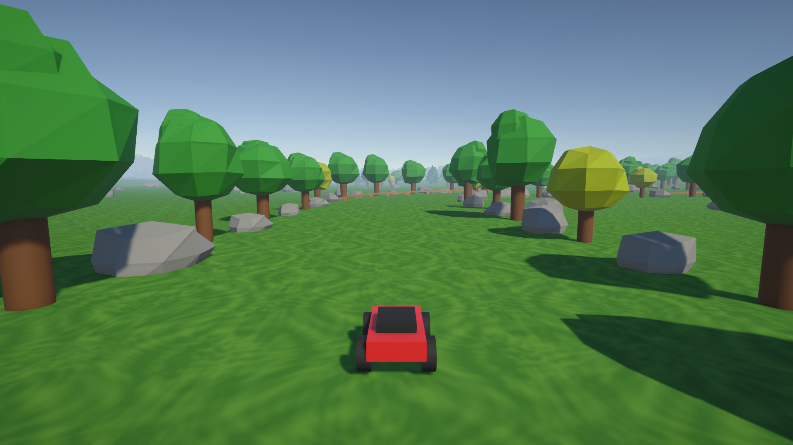

# 1. はじめよう（10 分）

> **この章でやること**：完成したゲームで遊んで、Unity の画面の名前を覚える。

## 1-1. ゲームで遊ぶ（5 分）

1. 画面の下にある **Project** で `Assets` → `Scenes` を開き、`00_Sample` をダブルクリックします。
2. 画面の上にある **▶（再生）ボタン** を押します。
3. 3, 2, 1, GO! のあと、**W A S D** キーで走ってみましょう。操作方法は画面の左下にも出ています。
4. もう一度 ▶ を押すと止まります。

| 操作 | キー |
| --- | --- |
| 進む・下がる | W / S |
| 曲がる | A / D |
| ジャンプ | Space |
| スピードアップ | 左 Shift |
| やり直し | R |

### コースのルール

- 道はありません。両側に並んだ **木と岩** の間を進みます。
- 木と岩の列から外に出ると「**コースアウト！**」と出て、少しすると前の場所に戻されます。
- 川や湖に落ちても、前の場所に戻されます。
- 途中にある **青い門（チェックポイント）** を全部通らないと、ゴールできません。

> 💡 1 周 5 分くらいかかります。授業では、少し遊んだら止めて大丈夫です。

## 1-2. 画面の名前を覚える（5 分）

Unity の画面は、いくつかの「窓」に分かれています。

| 窓の名前 | 何が出ているか |
| --- | --- |
| **Hierarchy**（ヒエラルキー） | シーンに置いてあるもの（オブジェクト）の一覧 |
| **Scene**（シーン） | ステージを作るための画面。ぐるぐる見回せる |
| **Game**（ゲーム） | 遊ぶ人が見る画面 |
| **Inspector**（インスペクター） | 選んだオブジェクトに付いている部品と、その設定 |
| **Project**（プロジェクト） | ファイルの一覧 |

### オブジェクトってなに？

シーンに置いてあるもの 1 つ 1 つを **オブジェクト** といいます。
**Hierarchy に並んでいる 1 行 1 行が、それぞれ 1 つのオブジェクト** です。

| Hierarchy の行 | どんなオブジェクト？ |
| --- | --- |
| RCCar | ラジコンカー |
| Terrain | 地面（草原や丘） |
| MainCamera | 画面を映すカメラ |
| GameManager | ゲームの進行係。目には見えないけれど、これもオブジェクト |

- Hierarchy でオブジェクトを **クリック** すると、Inspector にそのオブジェクトの中身（部品）が出ます。
- 左に **▶** があるオブジェクトは、中に別のオブジェクトが入っています。▶ を押すと開けます（例：RCCar の中には車体やタイヤが入っている）。

### Scene ビューの操作方法

Scene ビュー（シーンの画面）は、カメラを持ってステージの中を飛び回るように動かせます。
マウスのカーソルを **Scene ビューの上に置いてから** 操作しましょう。

| やりたいこと | やり方 |
| --- | --- |
| 見回す（その場で首を振る） | マウスの **右ボタン** を押したまま、マウスを動かす |
| 前後左右に飛び回る | マウスの **右ボタン** を押したまま、**W A S D**（**Q** で下、**E** で上） |
| 速く飛び回る | 右ボタン ＋ W A S D のときに、**Shift** も押す |
| 近づく・離れる（ズーム） | マウスの **ホイール** を回す |
| 画面を上下左右にずらす | マウスの **ホイールを押し込んだまま** ドラッグ |
| 見ているものの周りをぐるっと回る | **Alt** キーを押したまま、マウスの **左ボタン** でドラッグ |
| オブジェクトの所へ飛ぶ | Hierarchy でそのオブジェクトを **ダブルクリック**（Scene ビューでクリックして **F** キーでも OK） |
| 真上・真横から見る | Scene ビューの右上にある矢印（**ギズモ**）の **Y**（真上）・**X** / **Z**（真横）をクリック |

> 💡 迷子になったら、Hierarchy で **RCCar** をダブルクリックすると、車の所に戻ってこられます。

> 📖 **その他の便利機能**：飛び回る速さの変え方、車を追いかけ続ける方法（Shift + F）などは [Unity 操作のコツ](../manual/editor-shortcuts.md) にまとめています。

> ⚠ 右ボタンを押していないときに W / E / R キーを押すと、オブジェクトを動かす道具に切り替わります（3 章で使います）。
> Scene ビューを見回すときは、**右ボタンを押しながら** W A S D を押しましょう。

### やってみよう

1. Hierarchy で **RCCar**（ラジコンカー）をダブルクリックして、車に近づいてみましょう。
2. **Alt ＋ 左ドラッグ** で、車の周りをぐるっと 1 周回ってみましょう。
3. **右ボタン ＋ W** で、コースの先へ飛んでいってみましょう。青い門（チェックポイント）は見つかりましたか？
4. 右上のギズモの **Y** をクリックして、コースを真上から見てみましょう。
5. **RCCar** をクリックして、Inspector にどんな部品が並んでいるか見てみましょう。次の章で、この部品を変えていきます。

> ✅ **確認**：Hierarchy・Scene・Inspector がどれか、指でさして言えますか？

---

[← 授業の進め方](00_teacher-guide.md) ｜ [目次](../index.md) ｜ [2. 車を改造しよう →](02_components.md)
