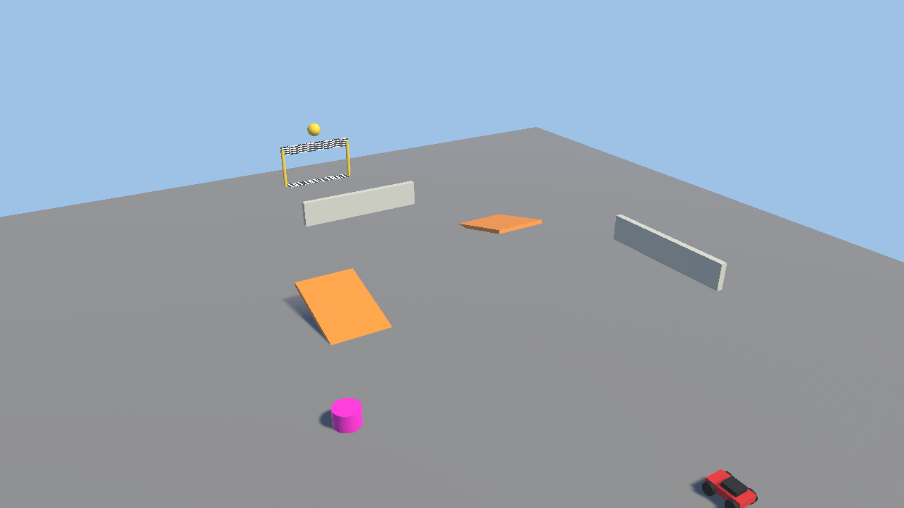

# 2. 車を改造しよう（20 分）

> **この章でやること**：車に付いている部品の数字を変えたり、部品を付け替えたりして、車を改造する。
> **使うシーン**：`Assets/Scenes/01_Lesson_Parts`

## コンポーネントってなに？

Unity のオブジェクトは、**コンポーネント（部品）** を組み合わせてできています。
プラモデルにパーツを付けるように、部品を付けたり外したりすると、できることが変わります。

Hierarchy で **RCCar** をクリックすると、Inspector に部品が並んでいます。

| 部品 | 役割 |
| --- | --- |
| Rigidbody | 重さや重力など、物が落ちたりぶつかったりするための部品（Unity にもとからある） |
| RCCar | ラジコンカーの本体 |
| ArcadeDrive | **駆動方式**。車がどんなふうに走るかを決める |

> 💡 部品のいちばん上にある **「▶ このコンポーネントについて」** を開くと、その部品の説明が読めます。
> 分からない部品があったら、まず開いてみましょう。

## 2-1. 数字を変えてみる（5 分）

1. ゲームが **止まっている** ことを確認します（▶ が青くなっていない状態）。
2. `Arcade Drive` の **Max Speed**（いちばん速いスピード）を 15 → 30 に変えます。
3. ▶ で再生して走ってみましょう。速くなりましたか？
4. 項目の名前にマウスを乗せると、説明が出ます。ほかの数字も変えてみましょう。

> ⚠ **再生中に変えた数字は、止めると元に戻ります。** 数字を変えるときは、止めてから変えましょう。

## 2-2. 走り方を付け替える（8 分）

1. `Arcade Drive` の右上にある **⋮** をクリックして、**Remove Component**（部品を外す）を選びます。
2. Inspector のいちばん下の **Add Component**（部品を付ける）を押します。
3. **VantanSchoolFestival2026** → **駆動方式** → **ドリフト (DriftDrive)** を選びます。
4. 再生してみましょう。曲がるときに滑るようになりましたか？
5. 同じやり方で **タンク (TankDrive)** にも替えてみましょう。止まったままでも回れますか？

| 駆動方式 | 走り方 |
| --- | --- |
| ArcadeDrive | 素直に曲がる。いちばん運転しやすい |
| DriftDrive | 横に滑る。Grip を小さくすると、氷の上のようにツルツル |
| TankDrive | 戦車のように、その場でくるっと回れる |

> ⚠ 駆動方式は **1 つだけ** 付けます。1 つも無いと走らず、2 つ付けると変な動きになります。

## 2-3. パーツを足す（5 分）

**Add Component** → **VantanSchoolFestival2026** → **追加パーツ** から付けてみましょう。追加パーツは、いくつ付けても大丈夫です。

| パーツ | できるようになること |
| --- | --- |
| ジャンプ (JumpParts) | Space キーでジャンプ |
| ブースト (BoostParts) | 左 Shift キーでスピードアップ（画面に燃料のゲージが出る） |
| ボディカラー (ColorParts) | 車の色を変える |

**ボディカラーの使い方**：Hierarchy で RCCar の左の ▶ を開き、**Body** を Inspector の **Targets** の欄までドラッグします。
そのあと **Body Color** で好きな色を選びましょう。再生しなくても色が変わります。

## 2-4. 操作のキーを変える（2 分）

再生中に **Tab** キーを押すと、操作のキーが **W A S D ⇔ 矢印キー** で切り替わります。画面左下の説明も変わります。

> ✅ **確認**：部品の数字を変えたり、付け替えたりするだけで、車の速さや走り方が変わりましたね。
> これが Unity の **「コンポーネント（部品）を組み合わせて作る」** という考え方です。

## もっとやりたい人へ

- Hierarchy の **FollowCamera**（車を追いかけるカメラ）を選び、**Follow Offset** の Y を 8 にすると、上から見下ろすカメラになります。
- 3 つの駆動方式で、一番気に入った走り方を見つけてみましょう。

---

[← 1. はじめよう](01_intro.md) ｜ [目次](../index.md) ｜ [3. コースを作ろう →](03_stage.md)
