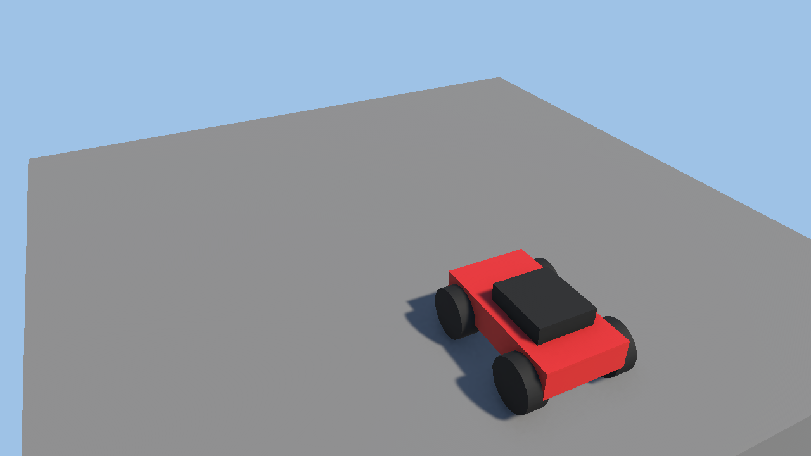

# 3. コースを作ろう（20 分）

> **この章でやること**：作り置きの部品（プレハブ）を置いて、スタートからゴールまで走れるコースを作る。
> **使うシーン**：`Assets/Scenes/02_Lesson_Stage`

`02_Lesson_Stage` を開くと、床とスタート地点と車しかありません。ここに自分のコースを作っていきます。
この章で作ったコースは、次の 4 章でも使います。

## プレハブってなに？

**プレハブ** は「作り置きの部品」です。Project の `Assets/Prefabs/Stage/` にある部品を
Scene の画面にドラッグするだけで、何個でも置けます。

## 3-1. 部品を置いて動かす（7 分）

1. Project で `Assets` → `Prefabs` → `Stage` を開きます。
2. **Floor**（床）を Scene の画面にドラッグして置きます。
3. 置いた Floor をクリックして選び、キーボードの **W / E / R** で道具を切り替えて動かしてみましょう。

| キー | 道具 | 使い方 |
| --- | --- | --- |
| W | 移動 | 赤・緑・青の矢印をドラッグ |
| E | 回転 | 輪っかをドラッグ |
| R | 大きさ | 四角をドラッグ |

> 💡 **Ctrl を押しながらドラッグ** すると、きりのいい場所でピタッと止まります。
> 間違えたら **Ctrl + Z** で 1 つ前に戻せます。

> 📖 **その他の便利機能**：**Ctrl + D** で同じ部品を複製する、**V** キーで床の角と角をくっつける（頂点スナップ）、地面の上に乗せる（表面スナップ）などは [Unity 操作のコツ](../manual/editor-shortcuts.md) にまとめています。

## 3-2. コースをつなげる（10 分）

次の部品を使って、スタートからゴールまでの道を作りましょう。

| 部品 | 説明 |
| --- | --- |
| Floor | 床。R キーで長くしたり広くしたりできる |
| Wall | 壁。コースから落ちないように横に置く |
| Ramp | 坂。ジャンプ台にもなる |
| Goal | ゴール |
| KillZone | 落ちたら戻される場所（見えない） |

1. **Floor** を並べたり伸ばしたりして、道を作ります。曲がり角も作ってみましょう。
2. 道の最後に **Goal** を置きます。
3. コースの下に **KillZone** を置いて、R キーで大きく広げます（落ちたときにスタートへ戻れるようにするため）。
4. ▶ で再生して、ゴールまで走れるか試してみましょう。

> 💡 走ってみて、落ちやすい所に **Wall** を置いたり、道を広くしたりして直しましょう。
> 車が止まってしまう所があったら、メニュー **VantanSchoolFestival2026 → ステージチェッカー** の **走れる場所を表示** を押してみましょう。赤いマスが、車が乗り越えられない段差です。
> 「作る → 遊ぶ → 直す」をくり返すのが、ゲーム作りのコツです。

## 3-3. 保存する（1 分）

キーボードの **Ctrl + S** でシーンを保存します。画面の上のシーン名に `*` が付いていたら、まだ保存されていません。

> ✅ **確認**：スタートからゴールまで、落ちずに走れるコースができましたか？

---

[← 2. 車を改造しよう](02_components.md) ｜ [目次](../index.md) ｜ [4. コースを仕上げて遊ぼう →](04_finish.md)
