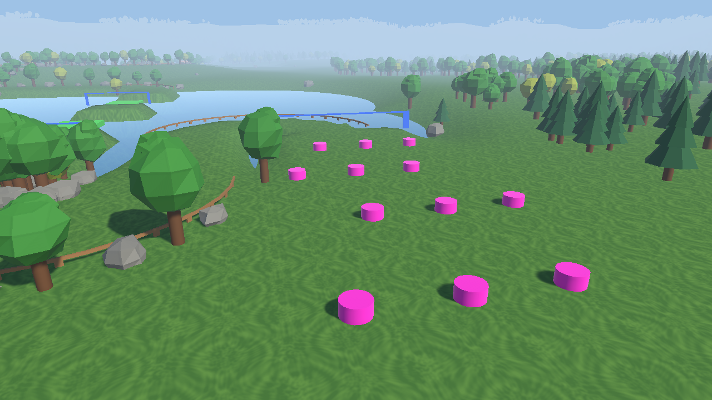
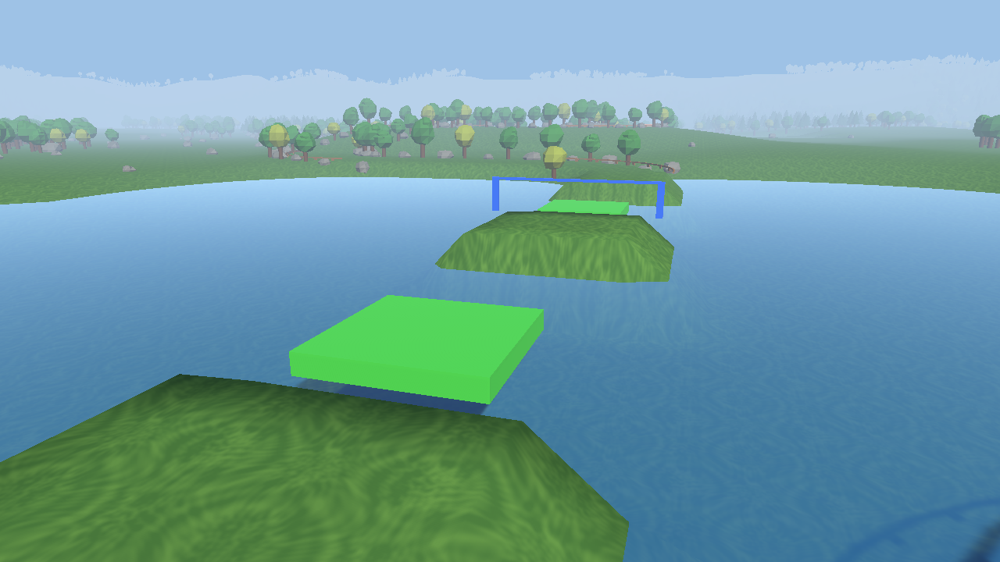

# 4. コースを仕上げて遊ぼう（20 分）

> **この章でやること**：3 章で作ったコースに仕掛けや飾りを足して、友だちと遊び合う。
> **使うシーン**：`Assets/Scenes/02_Lesson_Stage`（3 章の続き）

## 4-1. 仕掛けを置く（7 分）

`Assets/Prefabs/Stage/` には、コースを楽しくする仕掛けがあります。置いて走ってみましょう。

| 仕掛け | 何が起きるか | 変えられる数字（Inspector） |
| --- | --- | --- |
| SpeedPad | 通るとスピードアップ。矢印の向きに加速する | Push Power（押し出す強さ） |
| Bumper | ぶつかると、はじき飛ばされる | Bounce Power（はじく強さ） |
| MovingFloor | 行ったり来たりする床。乗ると一緒に運ばれる | Move Offset（どこまで動くか）、Travel Time（片道の時間） |

> 💡 上の写真は、完成版のコース（00_Sample）で仕掛けを使っている場所です。どんな置き方をするとおもしろいか、参考にしましょう。

1. 好きな仕掛けを 2 つ以上置いてみましょう。
2. 置いた仕掛けを選んで、Inspector の数字を変えてみましょう。**その仕掛けだけ** 性質が変わります。
3. 再生して、難しすぎないか・簡単すぎないか試しましょう。

> 💡 同じプレハブを 2 つ置いても、それぞれ違う数字にできます。弱い SpeedPad と強い SpeedPad を並べてみよう。

> 📖 コースアウトまでの時間など、ほかに変えられる数字は [調整できる数字の一覧](../manual/parameters.md) を見てください。

## 4-2. チェックポイントを置く（3 分）

コースが長くなったら、途中に **Checkpoint**（青い門）を置きましょう。
落ちたとき、スタートではなく、最後に通ったチェックポイントから再開できるようになります。

1. コースの真ん中あたりに **Checkpoint** を置きます。
2. 道をふさぐ向きになるように、E キーで回します。
3. 再生して、チェックポイントを通ってからわざと落ちてみましょう。門の所から再開できましたか？

## 4-3. 飾りを置く（4 分）

`Assets/Prefabs/Nature/` には、木や岩があります。コースの周りに置いて、景色を作りましょう。

> 📖 **その他の便利機能**：木を 1 本置いたら **Ctrl + D** で複製して並べると早いです。**Ctrl + Shift** を押しながら動かすと、地面の上にピタッと乗せられます。くわしくは [Unity 操作のコツ](../manual/editor-shortcuts.md) を見てください。

| 飾り | 説明 |
| --- | --- |
| Tree_Round / Tree_Round_Yellow | 丸い木（緑・黄色） |
| Tree_Pine | とがった木 |
| Rock | 岩。R キーで大きさを変えられる |

> 💡 00_Sample のコースは、木と岩を道の両側に並べて「ここを走ってね」と伝えています。
> 飾りを並べるだけで、遊ぶ人に道を教えることができます。

## 4-4. 友だちと遊び合う（6 分）

1. **Ctrl + S** で保存します。
2. 隣の人と席を交換して、相手のコースを遊んでみましょう。
3. 遊んだら、相手に感想を 1 つ伝えましょう（例：「SpeedPad の所が気持ちよかった」「Bumper が難しかった」）。

> ✅ **確認**：仕掛けを置いて数字を変えたり、友だちのコースで遊んだりできましたか？

## 時間が余ったら

- 2 章のように車を改造して（ジャンプ・ブースト・色）、自分のコースに合った車にしてみましょう。
- 上級者向けの [問題を直そう](../advanced/01_debug.md) に挑戦してみましょう。

---

[← 3. コースを作ろう](03_stage.md) ｜ [目次](../index.md) ｜ [まとめ →](05_wrapup.md)
